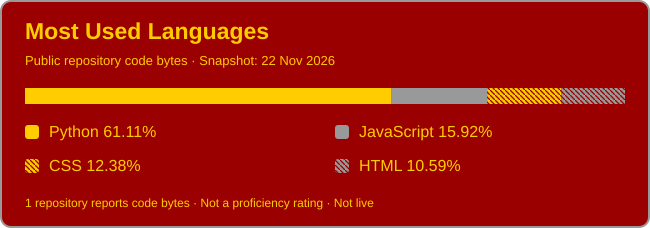

  

# Hi, I'm Subhradeep 👋

I'm an Indian Army-trained IT graduate with a master's in communication, exploring the space between technology, communication, and design. I enjoy turning ideas into clear digital experiences, from UI/UX concepts to small web projects.

## 🧭 About me

- 🎓 B.E. in Information Technology, University Institute of Technology, The University of Burdwan.
- 📚 Pursuing an M.A. in Journalism and Mass Communication at IGNOU.
- 📝 Experience in strategic communication and public information through Indian Army.
- 🏅 Grand finalist, Creators Challenge at Indian Army Terrier Cyber Quest 2026.
- 🌱 Learning Python, JavaScript, documentation and testing through hands-on projects.

## 💼 My roles & experience

My background includes product/UI/UX work and a trainee software role(SSE-0)  at Simpsoft Solutions, alongside experience in sales, business development and community activities.

## 🏅 Achievements

## 🛠️ My toolkit

### 💻  technologies

### 🎨 Design & media tools

Also: video editing and content writing.

### ))Currently learning

Python · JavaScript · Clear documentation · Tests

##  ))Featured projects

### [CyberDesk](https://github.com/Subhradeeppramanick/cyberdesk)

A **personal portfolio demo** of a cybercrime-complaint triage dashboard, using fictional sample data. Offline by default, not an official police or Army system.

- Python backend with HTML, CSS and JavaScript
- Rule-based triage with explanations
- Offline URL-risk scoring and sample IFSC lookup
- 25 unit tests

### [Car rental UI/UX](https://github.com/Subhradeeppramanick/car-rental-ui-ux)

A UI/UX design project for a Kolkata-based car-rental application.

### [Nation Building website](https://subhradeeppramanick.github.io/nation-building/)

A personal project website on the Indian Army's role in nation building, using public official sources only. Not an official site.

## 🤝 Socials & activity

[Explore my repositories and GitHub activity](https://github.com/Subhradeeppramanick)

## 📊 Top languages

*Based on GitHub's language-byte data across my public repositories. Only CyberDesk reports recognized language bytes in this snapshot; the other three report none. This card is a dated snapshot, not a live statistic.*

## 👁️ 

---

*Personal portfolio. Views and projects are my own. No institutional endorsement is implied.*

